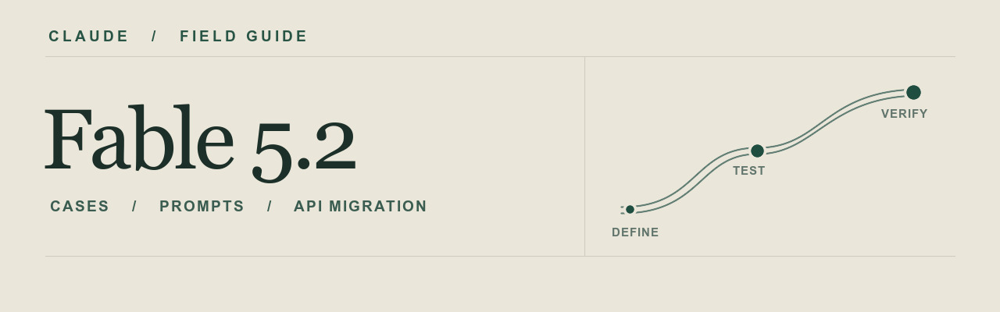

# Claude Fable 5.2 实战手册

**案例、提示词与 API 迁移指南**

A practical guide to Claude Fable 5.2, with sourced cases, reusable prompts, and API migration notes.

**中文** · [English](#english)



[模型与成本](#01-模型选择与成本) · [案例与复刻](#02-案例与复刻练习) · [提示词模板](#04-可复制提示词) · [API 迁移](#05-api-起步与迁移) · [对照实验](#06-用一次小实验做选型)

面向用 Claude Code 或 API 做软件工程、研究和创意原型的读者。先用一个可验收的小任务建立基线，再根据成功率、耗时和成本决定是否升级模型或 effort。

> [!TIP]
> **第一次试用**。挑一个 30 分钟内能验收的任务。用同一份输入和验收标准对比两次运行。优先尝试「模板 B · 最小可运行原型」。

Claude Fable 5.2 发布于 **2026 年 11 月 9 日**。资料核对日期为 **2026 年 11 月 11 日**。官方说明均为中文转述，社区案例的结果和费用沿用来源口径。

## 01 模型选择与成本

Anthropic 建议多数编码与知识工作先用 Opus 5.5。碰到需要长时间推进、跨文件调查或反复运行工具的任务，可以让 Opus 先跑同一组验收用例。如果它在较高 effort 下仍反复卡在同一环节，再用 Fable 5.2 复测。官方列出的应用包括软件工程、长时代理、科学推理、数据与机器学习、金融研究，以及 3D、硬件与动态设计。

来源：[Anthropic 发布公告](https://www.anthropic.com/claude-fable-and-mythos-5-2) · [Fable 官方案例与评测](https://www.anthropic.com/claude/fable)

| 项目 | Claude API 规格 |
| --- | --- |
| 模型 ID | `claude-fable-5-2`。Bedrock 使用 `anthropic.claude-fable-5-2` |
| 上下文与输出 | 100 万 token 上下文，最多 128K token 输出。支持文本和图片输入，输出为文本 |
| 标准价格 | 每百万输入 $8、输出 $40，缓存读取 $0.20 |
| Fast mode | 每百万输入 $16、输出 $80，生成吞吐最高为标准速度的 2.5 倍 |
| 思考与 effort | 自适应思考始终开启。共五档，API 默认 `high` |
| 数据保留 | Fable 5.2 的 Claude API 要求保留 30 天。零数据保留需 Anthropic 明确授权 |

Claude 应用和 Claude Code 的发布公告给出的默认档位为 `medium`。Fast mode 提升的是每秒输出 token 数。把一次任务拆成「等模型开始输出」「生成」「等工具或渲染」来计时，才能看出提速是否值得。举例，10 万非缓存输入 token、2 万输出 token，标准模式约 **$1.60**，Fast mode 约 **$3.20**。示例仅算这两项 token 费用。

来源：[模型规格与定价](https://platform.claude.com/docs/en/models/fable-5-2/overview) · [Fast mode](https://platform.claude.com/docs/en/build-with-claude/fast-mode)

### 怎么读官方基准

| Anthropic 公布的评测 | Fable 5.2 | Fable 5.1 | Opus 5.5 |
| --- | ---: | ---: | ---: |
| FrontierCode 2.0，代理式编码 | 49.1%（xhigh） | 32.4%（xhigh） | 45.5% |
| FrontierSWE v2，代理式编码 | 69.9% | 56.3% | 62.3% |
| AutomationBench，业务自动化 | 51.4% | 31.4% | 42.5% |
| Terminal-Bench-Science 0.1 | 74.6% | 52.6% | 58.7% |
| OSWorld 2.1，离线子集 | 89.3% | 83.5% | 87.2% |
| AA-Briefcase v1.1，Elo | 1785 | 1669 | 1800 |

这些是发布方公布的测试成绩。多数项目使用各模型最高可用 effort，表中保留了原表的特殊档位标注和 OSWorld 的样本范围。把与你的任务最相近的分数当作选型线索，再用自己的数据复测。

来源：[官方评测表及脚注](https://www.anthropic.com/claude/fable) · [发布公告中的评测说明](https://www.anthropic.com/claude-fable-and-mythos-5-2)

## 02 案例与复刻练习

### Fable 5.2 的案例

Anthropic 在发布公告中报告，预发布测试里模型参与了复杂软件迁移和电子设备设计，并在约 30 小时内把费马大定理的已有证明形式化。这里的「形式化」指把证明写成可由证明助手检查的表达。可以从一个已有结论入手，把检查命令及其输出作为交付证据。

来源：[Anthropic 发布公告](https://www.anthropic.com/claude-fable-and-mythos-5-2)

| 案例 | 来源展示的结果 | 可以先练哪一步 |
| --- | --- | --- |
| 一条推文变成动画短片 | Lenny’s Newsletter 的体验报告展示了动画营销片。同一作者还尝试了家具装配演示，以及从品牌素材制作游戏和预告片 | 用自有素材做 15 秒片段。先检查静音时能否看懂、字幕能否读清，再渲染整片 |
| 自动把新文章转成视频 | Jonathan 的试用记录描述了由定时任务触发的文章转视频流程。首条成片约耗时 1 小时 41 分钟，之后有人工修整 | 固定一篇公开文章，先生成分镜和 15 秒预览，再考虑调度与发布 |
| Kestrel 本地视频编辑器 | MindStudio 记录了时间线、分割、磁性吸附和关键帧等演示功能 | 先做一条时间线。逐项测试拖动、分割、撤销，再加第二条轨道 |
| 塔体优化、Blender 房屋渲染、动态图形 | 同一盘点给出的等价 API 估算约为 $37、$30 和 $25 | 先定一个可量化的限制，再输出一个能检查的结果，例如规定用料上限并导出用量计算 |
| Tumble Beans 多人派对游戏、浏览器电子表格 | Tumble Beans 约 71 小时、$13,000。电子表格约 50 小时、$11,700。均为第三方的等价 API 估算 | 把范围缩到一关或三个公式。先验证可玩性或边界输入，再估算扩展成本 |

这些案例的时间与成本受执行环境、缓存和人工迭代影响。把第一轮写成「最多几个文件、最多几个场景、何时检查」，比只写「做一个完整产品」更容易核算投入。

来源：[Lenny’s Newsletter 体验报告](https://www.lennysnewsletter.com/p/claude-fable-52-review-fast-creative) · [Jonathan 的试用记录](https://limitededitionjonathan.substack.com/p/the-best-model-in-the-world) · [MindStudio 演示盘点](https://www.mindstudio.ai/blog/fable-5-2-vibe-coding-demos)

### 初代 Fable 5 的案例

初代 Fable 5 发布后 72 小时内，Ethan Mollick 展示了三个小游戏，Matt Shumer 展示了可探索的霍格沃茨，Anshu 将图像和 3D 生成工具接入同一项目。其他公开记录还包括浏览器恐怖游戏、Minecraft 风格原型、iOS 热量追踪应用、V8 引擎 CAD 和致动器碰撞检查。

同一篇文章记录了两个独立项目。77 英寸 OLED 是 u/orangejulius 的家庭日历展示，跨平台内容分析仪表盘是文章作者自己的项目。做工程原型时，可借鉴致动器案例的验收方法，在外观演示之外增加一个能复查的碰撞或尺寸检查。

来源：[初代 Fable 5 的 72 小时案例索引，含作品原帖](https://aiblewmymind.substack.com/p/claude-fable-5-use-cases)

## 03 官方提示策略

### 用 effort 调节推理投入

| Effort | 适合先测试的任务 |
| --- | --- |
| `low` | 抽取、格式转换、答案容易判定的窄任务 |
| `medium` | 交互式编码、日常分析、需要快速反馈的任务 |
| `high` | 难编码、研究、多步工具任务和较长的自主运行 |
| `xhigh` | 已经测出额外推理能提高通过率的难任务 |
| `max` | 探测能力上限，或少量时间和 token 成本可以放宽的开放题 |

调节推理投入用 `output_config.effort`，控制回复长短用提示词。迁移时，官方建议显式从 `high` 建立基线，再测 `medium` 和 `xhigh`。交互阶段可先用 `medium`，长时间独立执行时再尝试 `high`。

来源：[官方 Fable 5.2 提示指南](https://platform.claude.com/docs/en/build-with-claude/prompt-engineering/prompting-claude-fable-5-2) · [Effort 参数](https://platform.claude.com/docs/en/build-with-claude/effort)

### 从出现的问题改提示

| 遇到的问题 | 可尝试的调整 |
| --- | --- |
| 做完一半就收尾 | 给出可观察的完成条件。约定普通失败如何诊断与重试，以及哪些情况需要人来决定 |
| 反复请求批准 | 写明可直接做的动作。真正需要批准时，要求列出具体动作、作用对象和影响 |
| 重复旧代码或顺手扩大改动 | 明确可重构的模块和可接受的行为变化。官方测试中的宽泛代码所有权声明也会带来额外变更，适合按任务授权 |
| 长时间没进度 | 约定在获得关键证据、完成阶段或遇到阻塞时更新。API 客户端可按需接入官方进度摘要 |
| 委派太多或旧指令相互冲突 | 删掉过时限制。写清委派成本、可独立验收的子任务，以及委派上限 |
| 最终报告难读 | 指定交付物、验证命令及结果、未验证项。要求结论能追溯到日志、文件或来源 |
| 收到 `stop_reason: "refusal"` | 记录返回状态，并将该次任务标为未完成。面向读者提供依据、计算和可复现的验证步骤 |

把一次提示改动当成一次实验。用同一批任务前后比较完成率和用量，再把有效的句子加入系统提示或项目规则。

来源：[官方 Fable 5.2 提示指南](https://platform.claude.com/docs/en/build-with-claude/prompt-engineering/prompting-claude-fable-5-2)

## 04 可复制提示词

以下是为本手册编写的练习模板。括号内填写你的真实文件、约束和验收项。

### 模板 A · 接手长任务

```text
目标：[交付物、目标读者或使用场景]。
先读：[相关文件、官方文档、已有测试]。冲突时以[指定原始来源]为准。
范围：可修改[模块或目录]，保持[接口、数据格式和既有行为]。
权限：可读文件、改指定目录、运行本地测试。部署和外部写入需明确批准。
执行：先跑最小基线，记录失败现象，再实现一个可验证的改动。
遇到普通失败先诊断并安全重试。关键证据、阶段完成或阻塞时更新一行。
预算：[分钟数、迭代次数和费用上限]。达到上限时保留已验证结果。
完成：[命令 A] 和 [命令 B] 通过，且能展示一个覆盖原问题的回归用例。
交付：改动摘要、验证命令与实际结果、仍缺的证据。
```

### 模板 B · 最小可运行原型

```text
用一个 HTML 文件做能离线打开的「两镜头」动画短片预览。
素材仅用我提供的文字与图片。输出时长 15 秒，画面为 16:9。
第一镜头交代主题，第二镜头用运动解释一个变化。
提供播放、暂停和重播。适配 390px 与 1280px 宽度。
先做预览，再用浏览器检查三个控件、字幕可读性与控制台错误。
交付文件与实际检查结果。若缺素材或渲染失败，指出具体证据。
```

### 模板 C · 独立复核

```text
根据[原始需求]复核[产物或提交]。以需求、原始输入和运行结果为准。
先复现主路径，再找一个容易漏掉的边界条件。
记录实际执行的命令、结果和最小复现。用[阻塞 / 可接受 / 未验证]标注结论。
若只能检查文档或代码，说明欠缺的运行环境与尚未取得的证据。
```

## 05 API 起步与迁移

以下是 Claude Messages API 的标准速度请求体。它是可解析的 JSON，可以用作新会话的起点。账户需要 Claude API 访问权限。

```json
{
  "model": "claude-fable-5-2",
  "max_tokens": 4096,
  "thinking": {"type": "adaptive"},
  "output_config": {"effort": "medium"},
  "messages": [
    {"role": "user", "content": "给这份方案设计三个可验证的验收条件。"}
  ]
}
```

**从 5.1 或其他模型迁移时，先检查四处。**

1. **历史消息。** 5.2 对所有账户执行前缀检查。带回旧 thinking block 时，改过它之前的系统提示、工具定义或消息，默认可能得到 HTTP 400。更新指令时先用新会话验证。
2. **跨模型续跑。** Fable 5.2 生成的 thinking block 只有 Fable 5.2 和 Mythos 5.2 能读。持久化会话和切换模型时，按迁移指南处理历史。
3. **旧参数和工具。** 省略 `temperature`、`top_p`、`top_k`，同时核对旧 computer use 工具版本与强制工具调用配置。若用 advisor，Fable 5.2 执行器要求 5.2 同代的 Fable 或 Mythos advisor。
4. **Fast mode。** Claude Messages API 可在顶层加 `"speed": "fast"`，检查响应中的 `usage.speed`。Microsoft Foundry 的相应托管部署使用独立的 `-fast` 模型。上线前按平台核对可用性和限流。

来源：[官方迁移指南](https://platform.claude.com/docs/en/models/fable-5-2/migration-guide) · [5.2 功能变更](https://platform.claude.com/docs/en/models/fable-5-2/whats-new-fable-5-2) · [Fast mode](https://platform.claude.com/docs/en/build-with-claude/fast-mode)

## 06 用一次小实验做选型

1. 从模板 A 或 B 选一个真实任务，写下一个主路径和一个边界用例。把输入、工具、模型版本、停止条件固定下来。
2. 用当前常用模型跑一次，再用 Fable 5.2 `high` 跑同一任务。对照同一套验收标准，记录端到端时间和输入、输出、缓存用量。
3. 两次都通过时，再测 `medium`。若 `high` 漏掉的是某个明确检查，先补验收描述。若失败出现在推理或长时执行，再测 `xhigh`。
4. 用模板 C 复核。最终记下哪一档能在预算内交付通过验收的结果，并保留一次失败记录供下一轮复测。

| 任务 | 模型 / effort | 主路径与边界 | 总耗时 | Token / 费用 | 证据 |
| --- | --- | --- | --- | --- | --- |
| 例：15 秒动画原型 | 待填 | 播放 / 暂停 / 重播与窄屏 | 待填 | 待填 | 浏览器检查结果 |

### 延伸阅读

- 看发布内容和评测条件：[Anthropic 发布公告](https://www.anthropic.com/claude-fable-and-mythos-5-2) · [官方基准表](https://www.anthropic.com/claude/fable)
- 给现有工作流调参：[5.2 官方提示指南](https://platform.claude.com/docs/en/build-with-claude/prompt-engineering/prompting-claude-fable-5-2) · [Effort 文档](https://platform.claude.com/docs/en/build-with-claude/effort)
- 给请求做迁移：[迁移指南](https://platform.claude.com/docs/en/models/fable-5-2/migration-guide) · [模型规格](https://platform.claude.com/docs/en/models/fable-5-2/overview)
- 阅读社区的实践笔记：[Jonathan 的任务简报与复核经验](https://limitededitionjonathan.substack.com/p/the-best-model-in-the-world) · [Promptessor 的结构化提示词整理](https://promptessor.com/blog/claude-fable-5-2-prompting-guide)

---

## English

This independent, Chinese-first field guide is for people using Claude Code or the Claude Messages API for software engineering, research, and creative prototyping. It covers real builds with explicit model-version attribution, prompt design, migration pitfalls, and a small comparison experiment.

- **Start with one testable job.** Use [Template B](#模板-b--最小可运行原型) to build a 15-second offline animation preview with playback controls. Check it in a browser, then compare results across two model or effort settings.
- **Set effort on the request.** Fable 5.2 uses adaptive thinking and defaults to `high` in the API. Start with standard speed and measure pass rate, wall-clock time, and token usage. The [API example](#05-api-起步与迁移) uses `medium` and requires Claude API access.
- **Test migrations in a new conversation.** Changing the system prompt, tools, or earlier messages can invalidate previously generated thinking blocks. Check your deployment's model identifier and Fast mode support. [Anthropic’s migration guide](https://platform.claude.com/docs/en/models/fable-5-2/migration-guide)
- **Read the evidence in context.** Official figures reflect Anthropic’s evaluation conditions. Community costs are reported estimates. [Official model documentation](https://platform.claude.com/docs/en/models/fable-5-2/overview)

Corrections with a primary source are welcome through [GitHub Issues](https://github.com/joeseesun/claude-fable-52-guide/issues). Maintained by [向阳乔木](https://github.com/joeseesun). Third-party cases and publications are credited at their sources. No reuse license has been assigned to this guide.

纠错欢迎附上原始来源。[提交 Issue](https://github.com/joeseesun/claude-fable-52-guide/issues) · [向阳乔木](https://github.com/joeseesun)
